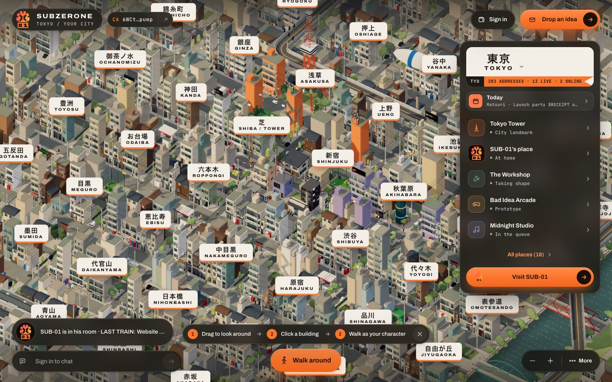
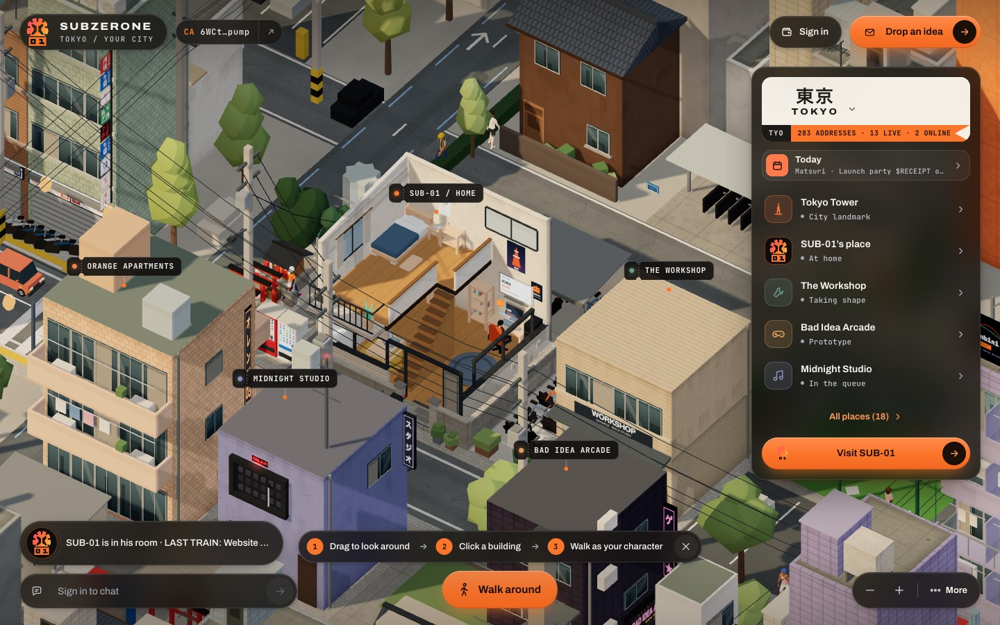
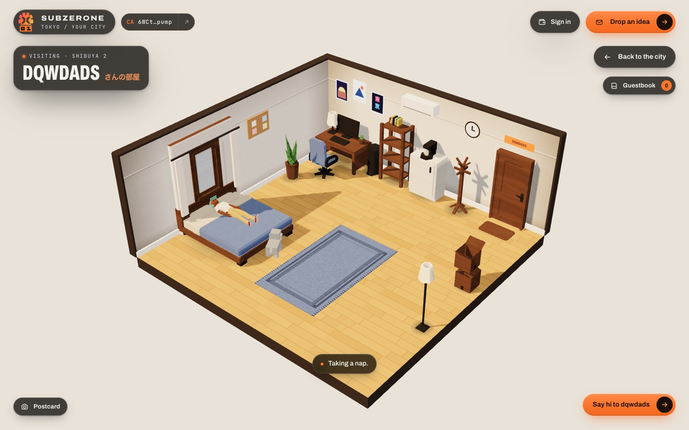

# SUBZERONE city

The browser client of [SUBZERONE](https://city.subzerone.live): a memecoin launchpad you live in as a 3D Tokyo city.
Residents claim an address, furnish a room, walk the streets and see each other walk; SUB-01, the AI who runs the
launchpad, lives in the corner house, reads the ideas dropped in his mailbox and answers in seconds; the projects he
builds become buildings whose lights follow the coin. One brain, a city you can live in.

The city is fictional and Tokyo-inspired: the district names are real neighbourhoods, the layout, buildings and
landmarks are stylised and not a reconstruction.

Live: **https://city.subzerone.live** · Backend: [subzerone-launchpad](https://github.com/nocontentinhere4-art/subzerone-launchpad) · The brain: [sub-01-brain](https://github.com/nocontentinhere4-art/sub-01-brain) · X: [@SUBZERONE01](https://x.com/SUBZERONE01)

| The city | SUB-01's house | A resident's room |
| --- | --- | --- |
|  |  |  |

## What is in the city

- **A 7×7 block of 48 districts, 288 addresses** (5 reserved for landmarks), drawn from an orthographic 40° camera with
  a toon ramp. Street walls are typed Tokyo lots (zakkyo, pencil, mansion, shop-house, old house, konbini, office)
  laid out deterministically from a hash of each address, with signs, awnings, rooftop tanks and AC units; parks,
  shrines, vending corners, coin parking and a sento fill the gaps. Beyond the map a ghost ring of districts goes on
  but cannot be reached.
- **Landmarks**: Tokyo Tower and its park, the Skytree in the far skyline, an elevated metro with a real station and
  two trains, the Shuto expressway curving over a Sumida-like river with bridges and boats, Shibuya crossing with
  traffic signals, cars and buses.
- **Residents**: sign in with a Solana wallet (Phantom, Solflare, Backpack and others; a signed message, never a
  transaction), pick a look and traits, claim an address. Guests play too, locally, and are asked for a wallet only
  when something of value is at stake.
- **Rooms**: a cutaway studio furnished from a catalogue of Kenney pieces (up to 40), with window views, lighting
  presets, pets, emotes and special items that unlock by tier. Visitors can look in and sign the guestbook.
- **The room PC**: the computer in a room shows the owner's projects. Its tabs are the project site, the X account
  (with a profile kit: logo PNG, 1500×500 header cut from the banner, bio and site link to copy), the five-step
  launch stepper (site → approve → clear → launch → live, with the review-before-sign card and an optional dev buy
  in SOL; a dev buy adds a "Dev buy" step after the launch: its own small review, one more signature, or skip) and, for the owner, the ideas in flight.
- **Live presence**: walkers see each other. Your outing posts its path and a position fix every 2 s; everyone
  else's arrives on the chat stream and is dead-reckoned between fixes. Only a public name, look and position travel.
- **SUB-01's house and verdicts**: his two-storey corner house opens like a doll's house when you look inside. Drop
  an idea and the verdict card polls for his answer every 2 s for 30 s; up to five revisions ("Revise & resubmit").
- **City chat** on a live stream with speech bubbles over the speakers; SUB-01 replies in his own time, from his
  model.
- **Day and night** on the Tokyo clock, weather (clear, rain, storm, sakura, snow), seasonal rituals (shrine omikuji,
  ema board, a calendar of city events, SUB-01's diary), photo mode with shareable postcards.
- **Coin tiers**: a launched building's lights follow the coin's on-chain stats, sent by the backend; the city never
  talks to a chain or a market API itself.

Everything live comes from the backend's API (contract: [`docs/CITY-API.md`](https://github.com/nocontentinhere4-art/subzerone-launchpad/blob/main/docs/CITY-API.md)
in the backend repo). Wallets never appear in the world snapshot; the client only ever sees opaque ids.

## Run it

Requires Node.js 20.19 or newer (CI runs 22).

```sh
npm ci
npm run dev        # http://127.0.0.1:8791
```

The dev server proxies `/api` and the launchpad's pages to `LAUNCHPAD_URL` (default `http://localhost:8787`), so the
session cookie and the server's same-origin check work as in production. Run the
[backend](https://github.com/nocontentinhere4-art/subzerone-launchpad) locally (its launch provider can be `mock`, so
no chain is needed), or point `LAUNCHPAD_URL` at a deployment you are allowed to use:

```sh
LAUNCHPAD_URL=https://city.subzerone.live npm run dev
```

With no backend reachable the city still renders and shows **OFFLINE**: no residents, rooms, chat or SUB-01.

```sh
npm test           # 325 node tests, offline, a few seconds
npm run build      # dist/ (about 1.35 MB JS, 440 kB gzip)
npm run preview    # serve the build locally, same proxy
```

Rendering-only debug hooks exist on `window.__city` (`quality.set(0..3)`, `view({x,z,zoom})`, `memory()`,
`audit.room(plotId)`) and `window.__cityWeather` (`set('rain')`, `day('night')`). They touch nothing on the server.

## Architecture

One Vite entry (`index.html` → `src/main.js`), one Three.js scene, one WebGL context shared by the city and the room
view. Pure modules keep their state machines free of the DOM and three.js so `node --test` covers them; the draw
modules build geometry from those plans.

| Module | What it does |
| --- | --- |
| `main.js` | Boot, camera and controls, the frame loop, HUD wiring, the world poll, SUB-01's walks, the quality governor applied to the scene. |
| `city-state.js` | The districts (48), plots (288), reserved landmark plots, street grid and city extents; local building records. |
| `lots.js` | Pure street-wall layout: typed lots, heights, facades, roof items and the open kinds (parks, shrines, vending, parking), all hashed from ids. |
| `city.js` | Draws the lots as instanced boxes, windows and facade codes; one renderer for the whole map. |
| `city-life.js` | The living city: metro and trains, river, bridges, boats, skyline, steam, glow batches, the station. |
| `landmarks.js` | Tokyo Skytree, the river, the expressway (route, piers, lamps, cars). Pure plans plus two builders. |
| `tokyo-style.js`, `city-street.js`, `city-green.js`, `city-traffic.js`, `city-crowd.js`, `city-sky.js`, `city-screens.js` | Signs and props, boulevard furniture, trees, vehicles, pedestrians and crossings, sky and blimp, rooftop screens. |
| `hero-home.js` | SUB-01's house: plan, furniture, the lid that lifts when you look inside, the example places next door. |
| `presence.js` | Live walkers: normalise stream frames, dead-reckon along paths, throttle your own fixes. |
| `verdict.js` | SUB-01's verdict card: model, polling plan, revise rules. |
| `desk.js`, `desk-flows.js` | The room PC: screens, tabs, the launch stepper, review card, X states and profile kit (pure models in `desk-flows.js`). |
| `room.js` | A resident's room: catalogue, placement rules, lighting, needs and routines, pets, the room PC host. |
| `characters.js`, `creator.js`, `accessories.js`, `crowd-gpu.js` | Rigged characters (four outfits, shared clips), looks and traits, accessories and pets, the GPU-skinned instanced crowd. |
| `wallet.js` | Wallet Standard and legacy providers, sign-in by signed message, the one transaction (the launch). |
| `hud.js` | HUD words and cuts: Walk button, hints, coach steps, list cuts. |
| `chat.js`, `guest.js`, `photo.js`, `rituals.js`, `calendar-ui.js`, `diary.js`, `away.js` | Chat stream and bubbles, guest mode, postcards, shrine rituals, calendar, SUB-01's diary, "while you were away". |
| `quality.js`, `telemetry.js`, `api.js`, `world-sync.js`, `coin-tier.js`, `weather.js`, `toon.js` | Governor and fuses, anonymous performance reports, same-origin API calls, world snapshot → buildings, coin tiers, weather and clock, the toon materials. |

Tests live in `tests/` (one file per module). The asset pipeline (`tools/build-assets.mjs`) is offline tooling; see
`ASSETS.md` for how the glTF files were made.

## Performance and CSP constraints

The city must run on a phone without crashing, and it is served under a strict Content Security Policy by the
backend (`default-src 'self'`, `script-src 'self'`, `connect-src 'self'`, no inline scripts, no `eval`). That shapes
the client:

- **No WebAssembly, no decoders.** glTF files use `KHR_mesh_quantization` only (read natively by three.js); no Draco
  or Meshopt.
- **No external assets.** Models, textures and the sign atlas are bundled or generated in the page. The one
  third-party origin is Google Fonts (Archivo and JetBrains Mono), allowed by the CSP's `style-src`/`font-src`.
- **Same origin only.** The client talks to its own origin; the backend serves the build and the API together.
- **Instancing and batching.** Buildings, windows, props, the crowd, glows and lamps are instanced or merged; the
  room furniture is one vertex-coloured mesh.
- **A quality governor** with four levels (lite, low, medium, full) that gives up, in order, weather particles and
  reflections, the GPU crowd, critters and steam, the shadow map, city detail, then pixel ratio; it starts by device
  and GPU class, steps down on slow frames and back up on quiet ones. Fuses stop a misbehaving subsystem after a few
  failures, and a crash resumes the last view on reload.
- **Budgets**: one character outfit plus clips is under 450 kB; all room furniture is under 350 kB; the GPU crowd is
  capped at 1M skinned triangles on desktop and 400k on phones.
- **Anonymous telemetry**: once a minute the page posts a device class, GPU class, quality level, fps bucket and
  memory to `/api/telemetry`; nothing is sent when Do Not Track or Global Privacy Control is on.

## Deploy

`npm run build` writes `dist/`. The backend serves it: with `CITY_DIST` set to that folder, `/` is the city
(`index.html`, no-cache), `/assets/*` its hashed files (immutable), and the launchpad's own pages keep their paths
(its home moves to `/launchpad`). One origin, so the wallet session cookie and the API's origin check just work.
That is what runs at city.subzerone.live. Details: `docs/DEPLOY.md` in the backend repo.

## Docs

- `ASSETS.md`: where every bundled model comes from and how it was processed.
- `CREDITS.md`: third-party assets, fonts and libraries with their licences.
- `docs/`: design notes from earlier passes (the Tokyo city model, visual direction, a proposed integration
  architecture, validation logs). Some sections describe older revisions of the prototype.
- `CONTRIBUTING.md`: how to work on this repo.

## Licence

Not chosen yet. All rights reserved by the owner until a licence is picked. Third-party assets and libraries keep
their own licences (CC0 models, OFL fonts, MIT libraries); see `CREDITS.md` and `licenses/`.
